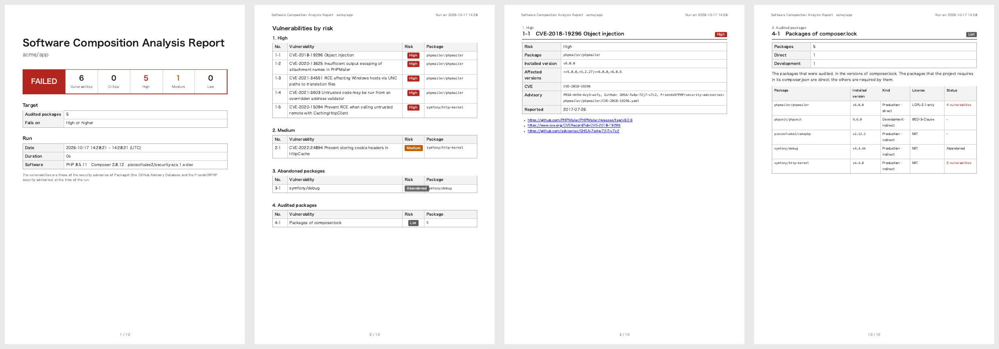

# Security SCA Documentation

Software composition analysis (SCA) of an application: the known vulnerabilities of its Composer packages,
checked with `composer audit`, as an A4 PDF report by CVE and risk, in the design of the reports of
[pieceofcake2/report](https://pieceofcake2.github.io/report/). The exit code fails CI when a vulnerability
reaches a risk.

- [Fixing a Vulnerability](fixing.md): reading an advisory, updating the package, and staying up to date
- [CI with GitHub Actions](ci.md)

It is one of the security checks of pieceofcake2, with
[pieceofcake2/security-sast](https://pieceofcake2.github.io/security-sast/) (the source code) and
[pieceofcake2/security-dast](https://pieceofcake2.github.io/security-dast/) (the running application);
pieceofcake2/security-check runs them all.

## What is Checked

Every package of `composer.lock`, the packages that the application requires and the packages that they
require, in the versions that are installed:

- **Known vulnerabilities**: the security advisories published for the installed version of a package, e.g.
  an SQL injection of a version of a library, with their CVE and risk (see
  [Where the Vulnerabilities Come From](#where-the-vulnerabilities-come-from))
- **Abandoned packages**: the packages that their authors no longer maintain (see
  [Abandoned Packages](#abandoned-packages))

The code of the application is not checked here: see
[pieceofcake2/security-sast](https://pieceofcake2.github.io/security-sast/) for it, and
[pieceofcake2/security-dast](https://pieceofcake2.github.io/security-dast/) for the running application.

## Requirements

- PHP 8.0+ and Composer 2.8+ (`composer audit` with the abandoned packages and the risks; update it with
  `composer self-update`)
- `composer.lock` in the project: the audit reads it, so the packages need not be installed
- Google Chrome or Chromium 131+ to print the PDF, and on Linux `fonts-noto-cjk` for a Japanese report

## Installation

```bash
composer require --dev pieceofcake2/security-sca
```

## Usage

```bash
vendor/bin/security-sca --pdf=tmp/security-sca.pdf --language=ja
```

| Option | Environment variable | Default | |
| --- | --- | --- | --- |
| `--pdf=PATH` | `SECURITY_SCA_PDF` | `tmp/security-sca.pdf` | The PDF report |
| `--fail-on=RISK` | `SECURITY_SCA_FAIL_ON` | `high` | The lowest risk that fails: `critical`, `high`, `medium`, `low` or `none` |
| `--no-dev` | `SECURITY_SCA_NO_DEV` | | Leaves out the development packages (`require-dev`); `--no-dev=0` keeps them when the settings file leaves them out |
| `--project=DIR` | | the current directory | The directory of `composer.json` and `composer.lock` |
| `--composer=COMMAND` | `SECURITY_SCA_COMPOSER` | `composer` | The Composer command |
| `--language=LANG` | `SECURITY_REPORT_LANGUAGE` | `en` | `en` or `ja`, or a language of `--locale-dir` |
| `--locale-dir=DIR` | `SECURITY_REPORT_LOCALE_DIR` | | `<language>.json` files that add or replace messages |
| `--title=TITLE` | `SECURITY_SCA_TITLE` | the title of the language | The title of the report |
| `--project-name=NAME` | `SECURITY_REPORT_PROJECT` | the name in `composer.json` | The project under the title |
| `--note=TEXT` | `SECURITY_SCA_NOTE` | | A note on the cover |
| `--settings=FILE` | `SECURITY_SETTINGS` | `config/security.php` or `app/Config/security.php` | The settings file |

The exit code is `0` when no vulnerability reaches `--fail-on`, `1` when one does, and `2` when the audit or
the report fails. A vulnerability whose risk is not known fails only with `--fail-on=low`.

The paths of the options and of the settings file (`--pdf`, `--project`, `--locale-dir`, `dir` of the report)
are relative to the current directory, not to the project: run the command in the project, or give absolute
paths.

### The Settings File

The settings of the security checks of pieceofcake2 can be kept in the project, in `config/security.php`
(`app/Config/security.php` of the legacy layout). It returns an array with a section for each check, and a
`report` section that they share:

```php
<?php
return [
    'report' => [
        'language' => 'ja',
        'dir' => 'tmp/security',
    ],
    'sca' => [
        'failOn' => 'medium',
        'noDev' => true,
    ],
];
```

The keys of the `sca` section are the options in camel case (`--fail-on` is `failOn`). The `report` section
has `language`, `localeDir`, `project` (the project name), `note` and `dir`, the directory of the reports (this
one is written to `tmp/security/security-sca.pdf`). An unknown key of the `sca` section is an error. The
options win over the environment variables, and the environment variables over the file.

## The Report

- [Sample report (English, PDF)](https://pieceofcake2.github.io/security-sca/report-sample.pdf)
- [Sample report (Japanese, PDF)](https://pieceofcake2.github.io/security-sca/report-sample-ja.pdf)



1. **Cover**: the result, the numbers of vulnerabilities by risk, the repository, branch and commit, the
   number of audited packages, the threshold, and the date, environment and software of the run
2. **Vulnerabilities by risk**: Critical, High, Medium, Low and Unknown, then the abandoned packages; each
   links to its page
3. **A page for each vulnerability**: its CVE (or GHSA ID when it has no CVE) and title, risk, package,
   installed and affected versions, the IDs of the advisory, the date of the report, and the links to the
   advisory, the CVE record and the GitHub advisory
4. **Ignored advisories**, when `composer.json` ignores some: each with its reason
   ([Ignoring an Advisory](#ignoring-an-advisory))
5. **Audited packages**: every package of `composer.lock` (without the development packages with `--no-dev`),
   with its version, whether it is a production or a development package, whether the project requires it
   directly or another package does, its licenses, and its vulnerabilities and whether it is abandoned. It is
   the inventory of what was checked, also when nothing was found

The vulnerabilities are those of the security advisories of Packagist at the time of the run: the GitHub
Advisory Database (reviewed advisories) and the FriendsOfPHP security advisories.

## Where the Vulnerabilities Come From

`composer audit` looks the packages of `composer.lock` up in the security advisories of Packagist, which come
from:

- the [GitHub Advisory Database](https://github.com/advisories?query=ecosystem%3Acomposer): the advisories that
  GitHub has reviewed. An advisory that a project has published on its repository appears after GitHub reviews
  it, which can take days
- the [FriendsOfPHP security advisories](https://github.com/FriendsOfPHP/security-advisories)

The risk is the one of the advisory (`critical`, `high`, `medium`, `low`); an advisory without one is
`unknown`. The report is the state of the advisories at the time of the run: run it again, e.g. every week in
CI, to see the advisories published since.

With Composer 2.10+, a package that matches a filter list of a repository (e.g. a list of malware) is reported as
a Critical vulnerability, titled with the list and its reason. When Composer cannot reach a repository, the
audit fails (exit code `2`, `composer audit failed`), unless `audit.ignore-unreachable` of `composer.json` is
`true`: then Composer audits the other repositories, the report lists the unreachable ones on the cover, the
command prints them, and the run passes or fails on the advisories that were found, which miss those of the
unreachable repositories.

## Abandoned Packages

A package that its author has marked as abandoned on Packagist is listed after the vulnerabilities, with the
package to use instead when the author gave one. It gets no fixes, also for vulnerabilities found later. The
abandoned packages do not fail the run; see [Abandoned Packages](fixing.md#abandoned-packages) for their
replacement.

## Fixing a Vulnerability

Most vulnerabilities are fixed by updating the package: `composer update vendor/package --with-dependencies`.
See [Fixing a Vulnerability](fixing.md) for reading an advisory, the packages that another package requires,
CakePHP, the abandoned and the development packages, and staying up to date.

## Ignoring an Advisory

When an advisory does not apply to the application, e.g. a vulnerability of Windows only, or of a feature that
the application does not use, ignore it in `composer.json` with the reason. It is then left out
of `composer audit` and of the report:

```json
{
    "config": {
        "audit": {
            "ignore": {
                "CVE-2021-34551": "Windows only: the application runs on Linux"
            }
        }
    }
}
```

The key is the CVE ID, the advisory ID (`PKSA-...`) or the ID of a source of the advisory, e.g. its GHSA ID. Update the package instead when you can:
an ignored advisory is easily forgotten.

The ignored advisories of the installed packages are still in the report, so that they are not forgotten: their
number on the cover, a group "Ignored advisories" after the abandoned packages, with a page for each with its
risk and the reason of `composer.json`, and "1 ignored" in the list of the audited packages. They do not fail the
run. Give a reason that can be checked again, e.g. "Windows only: the application runs on Linux".

## Troubleshooting

**`composer.lock is not found`**: run `composer install` (or `composer update`) in the project first, or give the
project with `--project`.

**`composer audit failed`**: the message of Composer follows, e.g. the network to `packagist.org` is not allowed,
or `composer.lock` is not valid. `composer audit` needs to download the advisories.

**`Composer 2.8.0 or later is needed`**: update Composer with `composer self-update`, or give a newer one with
`--composer`.

**`Unreachable repositories` on the cover**: with `audit.ignore-unreachable`, Composer could not download the
advisories of these repositories, e.g. a private repository without its credentials in CI, and their advisories
are missing although the run may pass. Check the network and `auth.json`, then run it again.

**The vulnerabilities of an advisory that was just published are missing**: it is not in the GitHub Advisory
Database yet (see [Where the Vulnerabilities Come From](#where-the-vulnerabilities-come-from)).

**`Chrome is needed to print the report`**: install Chrome or Chromium, or set `REPORT_CHROME_BINARY` (see
[pieceofcake2/report](https://pieceofcake2.github.io/report/)).
