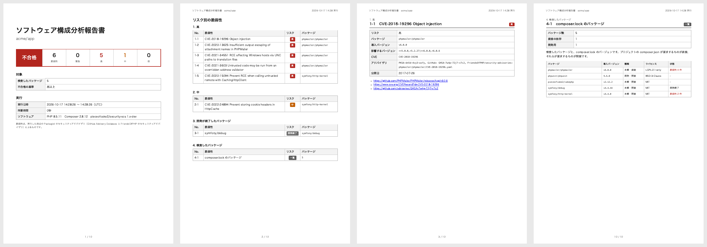

# Security SCA ドキュメント

アプリケーションのソフトウェア構成分析 (SCA) です。Composer のパッケージの既知の脆弱性を `composer audit` で調べ、
CVE とリスクごとの A4 の PDF の報告書にします。報告書は [pieceofcake2/report](https://pieceofcake2.github.io/report/ja/)
のデザインです。あるリスク以上の脆弱性があれば、終了コードで CI を失敗にします。

- [脆弱性を修正する](fixing.md): アドバイザリの読み方、パッケージの更新、最新に保つ方法
- [GitHub Actions での CI](ci.md)

pieceofcake2 のセキュリティ診断の 1 つで、ほかに [pieceofcake2/security-sast](https://pieceofcake2.github.io/security-sast/ja/)
(ソースコード) と [pieceofcake2/security-dast](https://pieceofcake2.github.io/security-dast/ja/) (動いているアプリケーション)
があります。pieceofcake2/security-check で、すべてを実行できます。

## チェックすること

`composer.lock` のすべてのパッケージ (アプリケーションが必要とするパッケージと、それらが必要とするパッケージ) を、
インストールされているバージョンで調べます。

- **既知の脆弱性**: そのバージョンのパッケージに公開されたセキュリティアドバイザリ。あるバージョンのライブラリの
  SQL インジェクションなどで、CVE とリスクも示します ([脆弱性の情報源](#脆弱性の情報源))
- **開発が終了したパッケージ**: 作者がもうメンテナンスしていないパッケージ ([開発が終了したパッケージ](#開発が終了したパッケージ))

アプリケーションのコードはここでは調べません。コードは [pieceofcake2/security-sast](https://pieceofcake2.github.io/security-sast/ja/)
で、動いているアプリケーションは [pieceofcake2/security-dast](https://pieceofcake2.github.io/security-dast/ja/) で調べます。

## 必要なもの

- PHP 8.0 以上と Composer 2.8 以上 (開発が終了したパッケージとリスクを返す `composer audit`。`composer self-update` で
  更新できます)
- プロジェクトの `composer.lock`。これを読んで調べるので、パッケージをインストールしておく必要はありません
- PDF を印刷するための Google Chrome または Chromium 131 以上。日本語の報告書には、Linux では `fonts-noto-cjk`

## インストール

```bash
composer require --dev pieceofcake2/security-sca
```

## 使い方

```bash
vendor/bin/security-sca --pdf=tmp/security-sca.pdf --language=ja
```

| オプション | 環境変数 | デフォルト | |
| --- | --- | --- | --- |
| `--pdf=PATH` | `SECURITY_SCA_PDF` | `tmp/security-sca.pdf` | PDF の報告書 |
| `--fail-on=RISK` | `SECURITY_SCA_FAIL_ON` | `high` | 不合格にする最も低いリスク。`critical`、`high`、`medium`、`low`、`none` |
| `--no-dev` | `SECURITY_SCA_NO_DEV` | | 開発用のパッケージ (`require-dev`) を除きます。設定ファイルで除いているときは、`--no-dev=0` で含めます |
| `--project=DIR` | | カレントディレクトリ | `composer.json` と `composer.lock` のディレクトリ |
| `--composer=COMMAND` | `SECURITY_SCA_COMPOSER` | `composer` | Composer のコマンド。`./composer.phar` や `php composer.phar` など。ファイルはカレントディレクトリからの相対パス |
| `--language=LANG` | `SECURITY_REPORT_LANGUAGE` | `en` | `en` か `ja`、または `--locale-dir` の言語 |
| `--locale-dir=DIR` | `SECURITY_REPORT_LOCALE_DIR` | | メッセージを足したり置き換えたりする `<言語>.json` のディレクトリ |
| `--title=TITLE` | `SECURITY_SCA_TITLE` | 言語のタイトル | 報告書のタイトル |
| `--project-name=NAME` | `SECURITY_REPORT_PROJECT` | `composer.json` の名前 | タイトルの下のプロジェクト名 |
| `--note=TEXT` | `SECURITY_SCA_NOTE` | | 表紙の注記 |
| `--settings=FILE` | `SECURITY_SETTINGS` | `config/security.php` か `app/Config/security.php` | 設定ファイル |

終了コードは、`--fail-on` に達する脆弱性がなければ `0`、あれば `1`、調査や報告書の作成に失敗したときは `2` です。リスクが
不明な脆弱性は、`--fail-on=low` のときだけ不合格になります。

オプションと設定ファイルのパス (`--pdf`、`--project`、`--locale-dir`、報告書の `dir`) は、プロジェクトではなく
カレントディレクトリからの相対パスです。プロジェクトで実行するか、絶対パスで指定してください。

### 設定ファイル

pieceofcake2 のセキュリティ診断の設定は、プロジェクトの `config/security.php` (従来の構成では `app/Config/security.php`)
にまとめられます。診断ごとのセクションと、共通の `report` セクションを持つ配列を返します。

```php
<?php
return [
    'report' => [
        'language' => 'ja',
        'dir' => 'tmp/security',
    ],
    'sca' => [
        'failOn' => 'medium',
        'noDev' => true,
    ],
];
```

`sca` セクションのキーは、オプションをキャメルケースにしたものです (`--fail-on` は `failOn`)。`report` セクションには
`language`、`localeDir`、`project` (プロジェクト名)、`note` と、報告書のディレクトリ `dir` があります (この例では
`tmp/security/security-sca.pdf` に書き出します)。`sca` セクションに知らないキーがあるとエラーになります。オプションが
環境変数より、環境変数が設定ファイルより優先されます。

## 報告書

- [見本の報告書 (日本語、PDF)](https://pieceofcake2.github.io/security-sca/report-sample-ja.pdf)
- [見本の報告書 (英語、PDF)](https://pieceofcake2.github.io/security-sca/report-sample.pdf)



1. **表紙**: 結果、リスクごとの脆弱性の数、リポジトリ、ブランチ、コミット、検査したパッケージの数、不合格の基準、実行の
   日時、環境、ソフトウェア
2. **リスク別の脆弱性**: 緊急、高、中、低、不明の順に並べ、最後に開発が終了したパッケージ。それぞれのページへのリンク付き
3. **脆弱性ごとのページ**: CVE (CVE がないものは GHSA ID) とタイトル、リスク、パッケージ、導入バージョンと影響する
   バージョン、アドバイザリの ID、公開日、アドバイザリ、CVE のレコード、GitHub のアドバイザリへのリンク
4. **除外したアドバイザリ**: `composer.json` で除外したものがあるとき。それぞれの理由も載せます
   ([アドバイザリを除外する](#アドバイザリを除外する))
5. **検査したパッケージ**: `composer.lock` のすべてのパッケージ (`--no-dev` では開発用を除く) と、そのバージョン、本番用か
   開発用か、プロジェクトが直接要求しているかほかのパッケージが要求しているか、ライセンス、脆弱性の件数と開発終了か
   どうか。何も見つからなかったときにも、何を検査したかの一覧になります

脆弱性は、実行した時点の Packagist のセキュリティアドバイザリによるものです。GitHub Advisory Database (審査済みの
アドバイザリ) と FriendsOfPHP のセキュリティアドバイザリが元になっています。

## 脆弱性の情報源

`composer audit` は、`composer.lock` のパッケージを Packagist のセキュリティアドバイザリで調べます。その元は次のとおりです。

- [GitHub Advisory Database](https://github.com/advisories?query=ecosystem%3Acomposer): GitHub が審査したアドバイザリ。
  プロジェクトが自分のリポジトリで公開したアドバイザリは、GitHub の審査の後に出てきます。審査には数日かかることがあります
- [FriendsOfPHP のセキュリティアドバイザリ](https://github.com/FriendsOfPHP/security-advisories)

リスクはアドバイザリのもの (`critical`、`high`、`medium`、`low`) で、ないものは `unknown` です。報告書は実行した時点の
アドバイザリによるものです。その後に公開されたアドバイザリを見るには、CI で毎週など、繰り返し実行してください。

Composer 2.10 以上では、リポジトリのフィルターリスト (マルウェアのリストなど) に当てはまるパッケージを、リストの名前と
理由を付けて、Critical の脆弱性として報告します。`composer.json` の `config.policy` で報告だけにした
リスト (`"audit": "report"`) は、Composer が不合格にしないので、リスクが不明の脆弱性として報告し、`--fail-on=low` のときだけ
不合格になります。Composer がリポジトリに到達できないときは、調査が失敗します
(終了コード `2`、`composer audit failed`)。`composer.json` の `audit.ignore-unreachable` が `true` のときだけは、Composer は
ほかのリポジトリを調べ、報告書の表紙に到達できないリポジトリを載せ、コマンドも出力します。合否は見つかった
アドバイザリで決まり、到達できないリポジトリのアドバイザリは抜けています。

## 開発が終了したパッケージ

作者が Packagist で開発の終了 (abandoned) を示したパッケージを、脆弱性の後に並べます。作者が示していれば、代わりの
パッケージも載せます。後で見つかる脆弱性も含めて、修正は出ません。開発が終了したパッケージで不合格にはなりません。
置き換え方は [開発が終了したパッケージ](fixing.md#開発が終了したパッケージ) をご覧ください。

## 脆弱性を修正する

ほとんどの脆弱性は、パッケージを更新すれば修正されます: `composer update vendor/package --with-dependencies`。
アドバイザリの読み方、ほかのパッケージが要求するパッケージ、CakePHP、開発が終了したパッケージと開発用のパッケージ、
最新に保つ方法は [脆弱性を修正する](fixing.md) をご覧ください。

## アドバイザリを除外する

Windows だけの脆弱性や、アプリケーションが使わない機能の脆弱性など、アプリケーションに当てはまらないアドバイザリは、
`composer.json` で理由と一緒に除外します。`composer audit` と報告書から除かれます。

```json
{
    "config": {
        "audit": {
            "ignore": {
                "CVE-2021-34551": "Windows だけの脆弱性。アプリケーションは Linux で動く"
            }
        }
    }
}
```

キーには、CVE ID、アドバイザリの ID (`PKSA-...`)、またはアドバイザリの情報源の ID (GHSA ID など) を書きます。除外したアドバイザリは忘れられがちなので、
できるだけパッケージを更新してください。

忘れられないように、インストールしているパッケージの除外したアドバイザリも報告書に載せます。表紙にその件数、開発が
終了したパッケージの後に「除外したアドバイザリ」のグループと、リスクと `composer.json` の理由を載せたそれぞれのページ、
検査したパッケージの一覧に「除外 1 件」です。不合格にはなりません。理由は「Windows だけの脆弱性。アプリケーションは
Linux で動く」のように、あとで確かめ直せるものにしてください。

## トラブルシューティング

**`composer.lock is not found`**: 先にプロジェクトで `composer install` (または `composer update`) を実行するか、
`--project` でプロジェクトを指定してください。

**`composer audit failed`**: 続けて Composer のメッセージが出ます。`packagist.org` へのネットワークが許可されていない、
`composer.lock` が正しくない、などです。`composer audit` はアドバイザリをダウンロードする必要があります。

**`Composer 2.8.0 or later is needed`**: `composer self-update` で Composer を更新するか、`--composer` で新しい
Composer を指定してください。

**表紙の「到達できないリポジトリ」**: `audit.ignore-unreachable` を設定していて、Composer がこれらのリポジトリの
アドバイザリをダウンロードできませんでした。CI で認証情報のないプライベートリポジトリなどです。合格していても、その
アドバイザリは抜けています。ネットワークと `auth.json` を確かめて、もう一度実行してください。

**公開されたばかりのアドバイザリの脆弱性が出ない**: GitHub Advisory Database にまだ載っていません
([脆弱性の情報源](#脆弱性の情報源))。

**`Chrome is needed to print the report`**: Chrome か Chromium をインストールするか、`REPORT_CHROME_BINARY` を設定して
ください ([pieceofcake2/report](https://pieceofcake2.github.io/report/ja/))。
